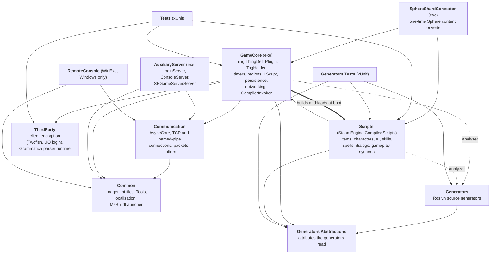

# Assembly dependency diagram

The projects in `SteamEngine.sln`, what each holds and what it references. For the role of
each project see [Architecture overview](../../current/01-overview/architecture-overview.md#top-level-projects-and-what-theyre-for).

Arrows point from a project to what it references. Transitive references (for example
Scripts → Common) are left out.

## Notes

- **Dotted arrows** are analyzer references (`OutputItemType="Analyzer"`): the generators run
  inside the compile of GameCore and Scripts and add code there. Nothing is written to disk;
  see [Scripting & code generation pipeline](../../current/02-engine-core/scripting-pipeline.md).
- **The thick arrow** is not a project reference. At boot GameCore builds
  `scripts/SteamEngine.Scripts.csproj` with MSBuild (or reuses the last build if nothing
  changed) and loads the resulting assembly (`GameCore/CompiledScripts/CompilerInvoker.cs`).
- **NuGet packages:** Scripts uses SharpZipLib and System.Management (`BackupsManager`) and
  MySql.Data; Generators uses Microsoft.CodeAnalysis.CSharp; the test projects use xUnit.
- **Not in the solution:** `tools/perf/stmbench` (a standalone benchmark) and the archived
  code under `archive/code/` at the repo root.
