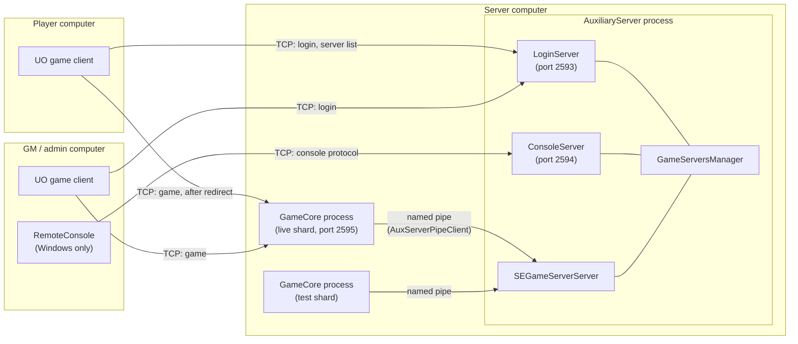

# Component interaction diagram

The processes of a running shard and how they talk to each other. For the prose version
see [Architecture overview](../../current/01-overview/architecture-overview.md).

## What each connection is for

- **Client → LoginServer (2593).** Account and password, server list, pick a shard. The
  login server then redirects the client to the chosen GameCore. See
  [AuxiliaryServer](../../current/06-tooling/auxiliary-server.md).
- **Client → GameCore (2595).** A new TCP connection after the redirect: character list,
  entering the world, and all gameplay. See
  [Networking & the protocol layer](../../current/02-engine-core/networking-protocol.md).
- **GameCore → AuxiliaryServer (named pipe).** GameCore connects back
  (`GameCore/AuxServerPipe/AuxServerPipeClient.cs`) so the AuxiliaryServer knows which game
  servers exist, can route logins to them and can forward console commands and log output
  (`AuxiliaryServer/SEGameServers/`).
- **RemoteConsole → ConsoleServer (2594).** An administrator's GUI. Commands go through the
  AuxiliaryServer to the GameCore it is logged in to; one console can watch several game
  servers. See [RemoteConsole](../../current/06-tooling/remote-console.md).

## Notes

- **Several game servers, one AuxiliaryServer.** The design lets one AuxiliaryServer serve
  several GameCore instances, for example a live shard and a test shard. Each connects back
  over its own named pipe, and `GameServersManager` keeps track of them. The full-boot tests
  (`Tests/Protocol/`) run their own AuxiliaryServer and GameCore pair instead; see
  [Test infrastructure](../../current/07-testing/test-infrastructure.md).
- **RemoteConsole** hasn't been actively developed lately, but this is still the intended
  admin path.
- The AuxiliaryServer can also launch a GameCore itself (`SEGameServerSetup`,
  `AuxServMsBuildProjectStarter`), and still carries a legacy Sphere-server path
  (`SphereServers/`), not shown here.
