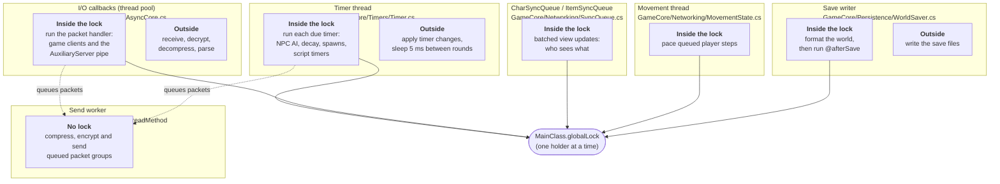

# Threading model

How GameCore runs game code on several threads while the world itself stays
single-threaded. The measurements and the reasoning behind this design are in
[Performance review](../../current/02-engine-core/performance-review.md#4-our-engine-main-loop-and-threads)
and [Multithreading with STM](../../current/02-engine-core/multithreading-and-stm.md).

**The rule:** there are several threads, but anything that touches the world runs inside
`lock (MainClass.globalLock)` (`GameCore/Main.cs`). Only one of them runs game code at a time,
so there is one *logical* game thread. Work that doesn't touch the world (encryption,
compression, sending, waiting for time) happens outside the lock.

## The threads

| Thread | Inside `globalLock` | Outside it |
|---|---|---|
| Timer thread | Runs every due timer, each in its own lock. NPC AI is a timer per NPC. | Applies timer changes, sleeps 5 ms. |
| I/O callbacks (thread pool) | Runs the packet handler. GameCore passes `globalLock` to its `GameServer` and to `AuxServerPipeClient`, so both game-client packets and AuxiliaryServer commands run under it. | Receives, decrypts and parses the packet. |
| Send worker | Nothing. | Compresses, encrypts and sends queued packet groups. |
| `CharSyncQueue`, `ItemSyncQueue` | Sends batched view updates. | Waits for work. |
| Movement thread | Paces queued player steps. | Waits for the next step. |
| Save | Formats every object, then runs `@afterSave` once the files are written. | Writes the files, on a worker thread when possible (#1209). |
| Console reader | Pressing Enter at the server console saves and exits (#1173). | Waits on `Console.ReadLine()`. |

The main thread only initializes the server and then waits for the exit token; there is no
main loop.

## Lock ordering

`globalLock` must be taken **before** any other lock that might also be taken while holding
it (#17, comment at `GameCore/Main.cs`). Every packet handler already holds it, so a code
path that takes another lock first and `globalLock` second can deadlock against them.
